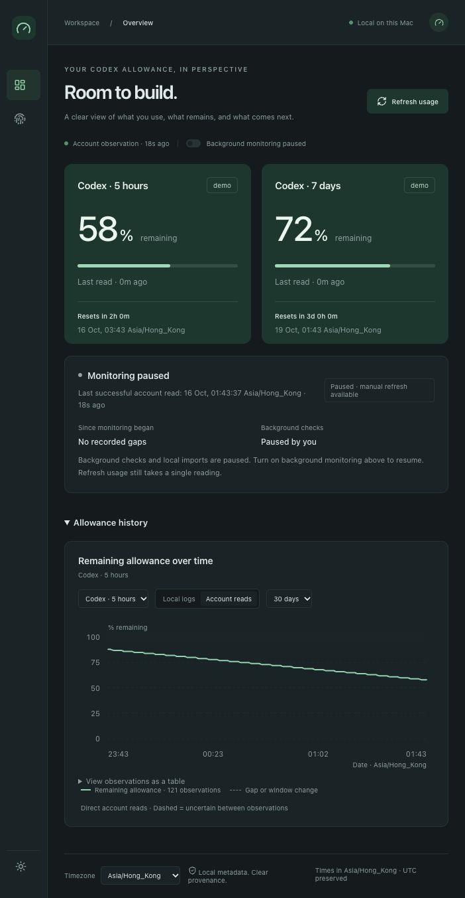

# QuotaScope

A private, local allowance dashboard for Mac users with a signed-in Codex account. See how much remains in each reported window, when it resets, and whether monitoring is healthy.

QuotaScope reads the allowance windows returned by your installed Codex app-server. It does **not** monitor every ChatGPT model, tool, device or subscription feature. It is an independent project, not an OpenAI product.



## Setup

Use macOS, Node.js 22.13 or later, npm, and a signed-in Codex CLI that supports `account/rateLimits/read`. Supported runtime and architecture checks are listed in [compatibility](docs/public/compatibility.md).

```sh
npm ci --ignore-scripts
npm run build
npm run doctor
npm start
```

Open <http://127.0.0.1:4317>. Doctor can report that the service is not running before the first start. For an executable outside PATH, set `QUOTASCOPE_CODEX` to its absolute path. Sign in through Codex itself; QuotaScope never changes authentication.

To keep monitoring after closing the dashboard and start at login:

```sh
npm run service -- install
npm run service -- status
```

The Mac must be awake and the user session active. Sleep, shutdown, sign-out and connectivity failures leave visible gaps; readings that were never collected cannot be recovered. There is no keep-awake behavior.

## Everyday use

Overview shows all current balances, reset times and monitoring health. Expand allowance history when needed. Details contains activity, evidence, backups, exports and optional comparison notes. Dates default to your browser's timezone; the footer lets you change it.

Account readings and local token logs are separate sources. Missing identities and gaps stay explicit. Estimates never become official quotas or price/value claims.

See the [operating guide](docs/public/guide.md) for startup, pause, recovery, configuration and updating a moved checkout. Read [privacy](PRIVACY.md) before exporting metadata or sharing a backup. [Contributing](CONTRIBUTING.md) describes fixture-only checks and release preparation. Licensed under [MIT](LICENSE).
